 

## 🎮 PLAYER 1: QUEM SOU EU?

Fala, player! 👾 Eu sou o **Ian Rodrigues Lima**, tenho **16 anos** e estou cursando o **ensino médio**. Minha maior paixão é **programação e tecnologia em geral**. Para mim, aprender a programar é como jogar um RPG: cada projeto é uma *quest*, cada bug é um *chefe* e cada linha de código que funciona vale um pouco de XP. ⚔️

Hoje estou na fase de **construir a base e me aprofundar**: estou começando a montar páginas com **HTML e CSS** e me aprofundando mais na prática com **C#**. Meu objetivo é continuar subindo de nível, criar projetos cada vez maiores e, quem sabe, desenvolver meus próprios jogos. 🕹️

## 🎒 INVENTÁRIO

**Equipado agora:**

**🔒 Próximas fases a desbloquear:**

## 🗺️ QUESTS

- [x] 🟢 Criar meu perfil no GitHub
- [ ] 🔵 Quest principal: terminar o ensino médio
- [ ] 🔵 Construir meu primeiro site com HTML + CSS
- [ ] 🔵 Dominar os fundamentos mais aprofundados de C# (orientação a objetos, grandes jogos na prática e etc)
- [ ] 🟣 Aprender outras linguagens
- [ ] 🟣 Aprender mais sobre front-end e back-end

## 📊 PLACAR

## 🐍 SNAKE: COMENDO MEUS COMMITS

<picture>
  <source media="(prefers-color-scheme: dark)" srcset="./profile/github-snake-dark.svg" />
  <source media="(prefers-color-scheme: light)" srcset="./profile/github-snake.svg" />
  
</picture>

## 📡 CONTATO

<!-- Quando quiser, adicione outros contatos aqui (use só os que você se sente seguro em divulgar):

-->

  

**▶ PRESS START TO CONTINUE ◀**

*Game over? Nunca. Só continue, tente de novo e suba de nível.* 🎮

